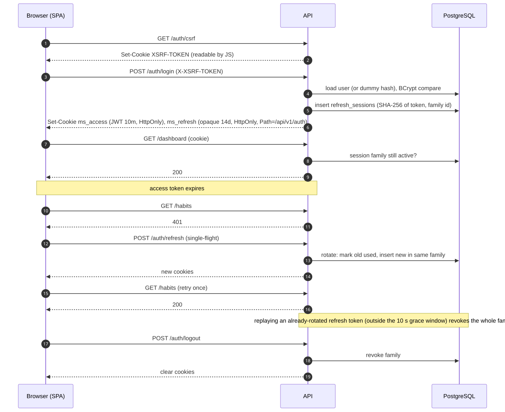

# MindSpace

A privacy-first mental-wellness and self-reflection app: daily mood check-ins, a private searchable journal, habit tracking with streaks, a calendar, insights, and a small wellness toolkit (breathing, grounding, prompts). It is a self-reflection tool, **not** medical care.

**Stack:** Java 21 · Spring Boot 3 (Security, REST, JPA, Flyway) · PostgreSQL 16 · React 18 + TypeScript + Vite + Tailwind · Docker Compose · GitHub Actions.

> ## Verification status (read this first)
> Verified by GitHub Actions on `ubuntu-latest` (all four CI jobs green on pull request #5; see the Actions tab):
>
> | Check | Result |
> |---|---|
> | PostgreSQL migrations V1–V6 + SQL test suite (plain `psql`, temporary cluster) | 173/173 assertions pass |
> | Backend: `mvn verify` — compile, unit tests, and 24 integration tests against a real PostgreSQL 16 (Testcontainers; Flyway migrations + Hibernate schema validation) | Pass |
> | Frontend: type-check, Vitest unit tests, production build | Pass |
> | End-to-end: Playwright against the full Docker Compose stack (db + backend + nginx/frontend) — register, sign in/out, protected routes, check-in, journal, habit, help page | Pass (3 smoke scenarios) |
>
> **Not covered by automated checks:** a visual review of the UI (no screenshots yet), accessibility audits, load testing, and most feature paths beyond the three E2E smoke journeys. Treat it as a well-tested portfolio project, not a hardened production service.

## Features
| Area | What it does |
|---|---|
| Auth | Register, login, logout, logout-everywhere, device list, password change. HttpOnly cookie sessions, refresh rotation with reuse detection, CSRF double-submit, rate limiting. |
| Dashboard | Today's check-in, check-in streak, 7-day mood strip, today's habits (one-tap), recent journal. |
| Check-ins | One per local day: mood/stress/energy 1–5, sleep, emotions, activities, private notes. Edit, delete, 30-day history. |
| Journal | Private CRUD, Postgres full-text search, tag and date filters, pagination, optional prompt. |
| Habits | Daily or N-per-week (Mon–Sun) habits, idempotent completions, pause/resume, current/longest/weekly streaks, consistency, per-week progress. |
| Calendar | Month grid shaded by mood with emotion/activity/mood filters and journal-day markers (never shows notes). |
| Insights | Weekly trend, daily lines, distribution, top emotions, sleep vs mood, habit vs mood, period comparison. Each chart has a table alternative. Hides comparisons below 5 observations. |
| Toolkit | Breathing (timed state machine), 5-4-3-2-1 grounding, reflection/gratitude prompts → journal, personal coping strategies (reorderable). |
| Get help | Crisis lines for India, US, UK/Ireland (checked 2026-10-20 against official/service pages). |
| Settings & privacy | Profile, time zone, theme, optional-analytics consent, JSON export of all data, permanent account deletion (password required). |

Every screen talks to a real endpoint; there is no mock data.

## Architecture


Modular monolith, package-by-feature (`com.mindspace.{auth,user,checkin,journal,habit,analytics,calendar,dashboard,wellness,privacy}`). Business rules that need no framework (streaks, rounding, week boundaries, password policy) live in `*.domain` / `common` packages and are unit-tested in isolation. Details: [docs/ARCHITECTURE.md](docs/ARCHITECTURE.md).

### Data flow – Level 0


### Data flow – Level 1


### Application flow


### Authentication flow


### Entity-relationship diagram


Schema notes, constraints and indexes: [docs/DATABASE.md](docs/DATABASE.md). Diagram sources are the `.mmd` files in `docs/diagrams/`.

## API
Base path `/api/v1`. Errors are RFC 9457 `application/problem+json` with a `requestId`. Full endpoint table: [docs/API.md](docs/API.md). Interactive OpenAPI: `/swagger-ui/index.html` (spec at `/v3/api-docs`) once the backend runs.

## Getting started

### Option A – Docker Compose (exercised in CI by the E2E job)
```bash
cp .env.example .env          # then set POSTGRES_PASSWORD and MINDSPACE_JWT_SECRET (>= 32 random bytes)
docker compose up --build     # app on http://localhost:8081
```

### Option B – local development
Prerequisites: JDK 21, Maven 3.9, Node 22, PostgreSQL 16.
```bash
createdb mindspace
cd backend && SPRING_DATASOURCE_URL=jdbc:postgresql://localhost:5432/mindspace \
  SPRING_DATASOURCE_USERNAME=... SPRING_DATASOURCE_PASSWORD=... \
  MINDSPACE_JWT_SECRET="$(openssl rand -hex 32)" mvn spring-boot:run
cd frontend && npm install && npm run dev      # http://localhost:5173, proxies /api to :8080
```

### Environment variables
| Variable | Purpose | Default |
|---|---|---|
| `POSTGRES_DB`, `POSTGRES_USER`, `POSTGRES_PASSWORD` | Compose database | `mindspace`, `mindspace`, **required** |
| `SPRING_DATASOURCE_URL/USERNAME/PASSWORD` | Backend DB connection | – |
| `MINDSPACE_JWT_SECRET` | HS256 signing key, ≥ 32 characters | **required** |
| `MINDSPACE_CORS_ALLOWED_ORIGINS` | Comma-separated browser origins | `http://localhost:5173` |
| `MINDSPACE_BCRYPT_STRENGTH` | BCrypt cost | `12` |
| `MINDSPACE_COOKIE_SECURE` | `true` when served over HTTPS | `false` |
| `E2E_BASE_URL` | Playwright target | `http://localhost:8081` |

No secrets are committed; `.env` is git-ignored. See `.env.example`.

## Testing
```bash
bash db/scripts/run-db-tests.sh                 # SQL suites on a temp PostgreSQL cluster (RAN: 173/173)
JUNIT_SHIM_DIR=... ./scripts/run-domain-tests.sh # pure Java with a JUnit stand-in (RAN: 63/63)
./scripts/javac-triage.sh                        # weak dependency-free compile signal (RAN)
cd backend && mvn verify                         # unit + Testcontainers ITs (passes in CI)
cd frontend && npm run typecheck && npm test     # (passes in CI)
cd frontend && npx playwright test               # needs docker compose up (passes in CI)
```
Strategy, what each layer proves, and the honest gaps: [docs/TESTING.md](docs/TESTING.md).

## Security
HttpOnly `SameSite` cookies (no tokens in JS or storage), 10-minute JWT + rotating opaque refresh token stored only as a SHA-256 hash, immediate server-side revocation, CSRF double-submit, BCrypt, constant-time login path, per-IP and per-e-mail rate limits, body-size limit, strict CSP/HSTS/no-referrer headers, user-scoped queries everywhere (other users' ids return 404), no secrets or journal text in logs. Threat model and trade-offs: [docs/SECURITY.md](docs/SECURITY.md).

## Deployment
Build two images (`backend/Dockerfile`, `frontend/Dockerfile`), run PostgreSQL 16 with a persistent volume, terminate TLS in front of nginx, set `MINDSPACE_COOKIE_SECURE=true`, a strong `MINDSPACE_JWT_SECRET` and the real origin in `MINDSPACE_CORS_ALLOWED_ORIGINS`. Set `MINDSPACE_API_DOCS_ENABLED=false` to hide Swagger/OpenAPI in production. The `prod` profile turns on secure cookies and JSON logs (note: Compose overrides `MINDSPACE_COOKIE_SECURE` to `false` so it works over plain http on localhost). Rate limiters are in-memory, so run **one** backend instance or replace them with a shared store first (see limitations).

## Screenshots
None yet. The UI has not been rendered because the frontend could not be built in the authoring environment. Add real screenshots after the first successful run.

## Known limitations
See [docs/LIMITATIONS.md](docs/LIMITATIONS.md). Highlights: unverified build; in-memory rate limiting; export built in memory; no e-mail/password reset or MFA; single-region helpline list; no offline support.

## Documentation
[ARCHITECTURE](docs/ARCHITECTURE.md) · [DATABASE](docs/DATABASE.md) · [API](docs/API.md) · [SECURITY](docs/SECURITY.md) · [TESTING](docs/TESTING.md) · [LIMITATIONS](docs/LIMITATIONS.md) · [DEMO_SCRIPT](docs/DEMO_SCRIPT.md)

## Repository layout
```
backend/   Spring Boot app, Flyway migrations, tests, Dockerfile
frontend/  React app, Vitest tests, Playwright specs, nginx config, Dockerfile
db/        SQL test suites and the temporary-cluster runner
docs/      architecture, security, API, testing docs; diagrams; verification logs
scripts/   run-domain-tests.sh, javac-triage.sh
.github/   CI workflow (never executed)
```
